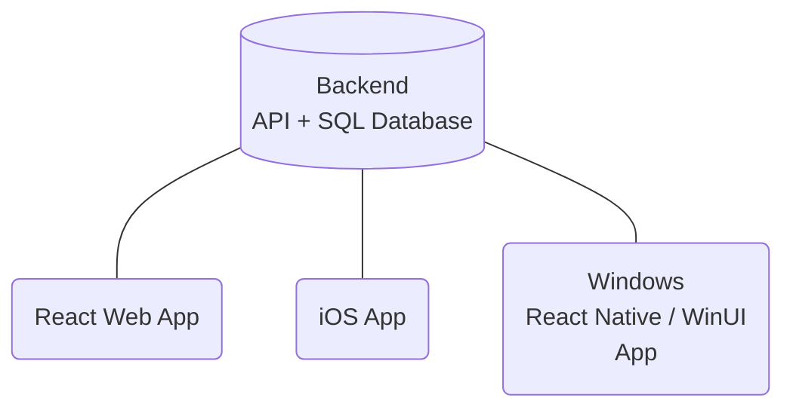
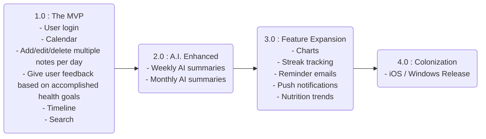
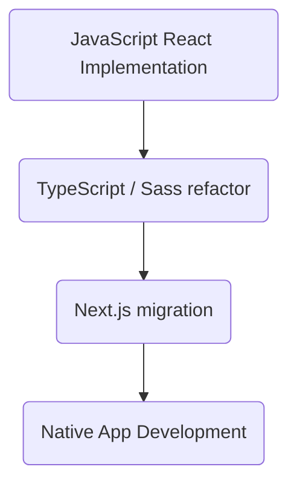
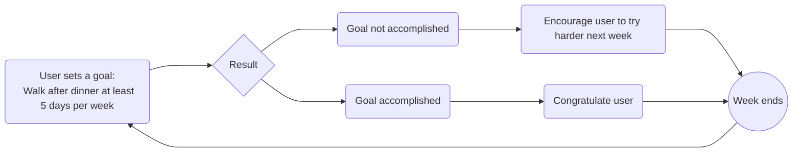

# Wellness Calendar

A cross-platform (status pending) wellness journal to help you stay accountable.

## Structure

[https://mermaid.ai/open-source/syntax/flowchart.html]: #

## Major Release Roadmap

## Technology Roadmap

## Note Formatting

### Meal Note

| Type of Note | Date |
| ------------------ | ----------- |
| Planned meal time | ... |
| Actual meal time |... |
| Pre-meal assessment | Hunger level: 0-10, type of hunger, environment |
| Meal details | food and drink consumed |
| Post-meal reflections | Fullness level: 0-10, type of hunger, environment |
| Grain, starch, or sugar? | (y/n) |
| Snacking? | (y/n) |
| Walked after meal? | (y/n) |

### Fitness Note

| Type of Note | Date |
| ------------------ | ----------- |
| Yoga | (y/n) |
| Time (auto-generated field) | t |
| Walking, hiking | (y/n) |
| Distance & Time | (d/t) |
| Other | ... |

## Goal Logic Example

*Goal logic should ultimately be based on unit values*

## Licensing

Add the proper MPL 2.0 header to source files: https://www.mozilla.org/en-US/MPL/headers/
