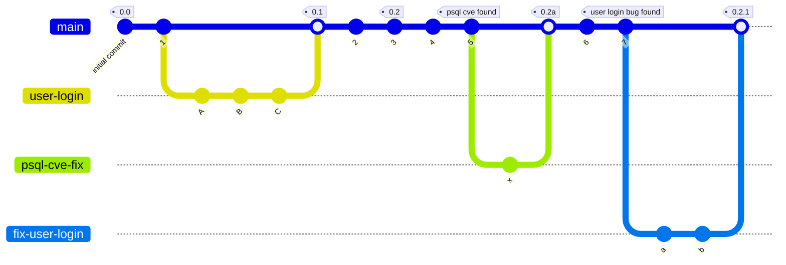

_https://mermaid.ai/open-source/syntax/flowchart.html_  
_https://expressjs.com/en/5x/starter/installing/_  

# Wellness Calendar

A cross-platform (status pending), simple lifestyle journal to help you stay accountable.

| Platform | Repo |
|----------|------|
| Web     | https://github.com/LowComDenom/wellness-calendar-web.git |
| iOS     | https://github.com/LowComDenom/wellness-calendar-iOS.git |
| Windows | https://github.com/LowComDenom/wellness-calendar-win.git |

Documentation currently lives in the `docs` folder.

# How to run

...

# Hosting options

* Render (required by course)
* Netlify (required by course)
* Cloudflare
* Google
* Railway
* Vercel
* Wordpress
* Convex
* Prisma

# Ideal client test environment

Chromium w/ React Dev tools extension

# Structure

```mermaid
flowchart LR

subgraph Backend
  DB[(-Database-)]
  r1{{db query}}
  API((-API-))
end

subgraph Client
  r2{{fetch}}
  CLI[-App-]
end

DB <--> r1 <--> API
API<--> r2 <--> CLI
```

# Major Release Roadmap

## 1.0 : The MVP

- [ ] Calendar UI
- [ ] User login
- [ ] Add/edit/delete multiple notes per day

## 2.0 : QoL / AI

- [ ] Timeline view
- [ ] Stats and Charts
- [ ] User feedback derrived from stats
- [ ] Theming
- [ ] Search
- [ ] User-generated note templates
- [ ] Pinned notes
- [ ] Reminder emails
- [ ] Push notifications
- [ ] OAuth
- [ ] LLM integrations for smarter feedback
- [ ] Native OS calendar interaction

## Platform Expansion Versions

- [ ] 3.0 : React Native App
- [ ] 3.0 : SwiftUI app
- [ ] 3.0 : WinUI 3 app

## Versioning Scheme

https://semver.org/

### Representation of implementing the first feature on the web front end, then finding a bug later


