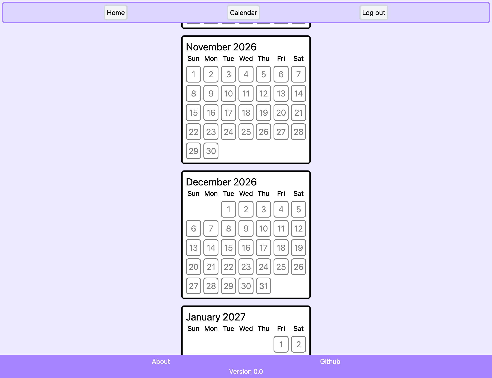

# Wellness Calendar

A cross-platform simple lifestyle journal to help you stay accountable.

| Platform | Repo |
|----------|------|
| Web     | https://github.com/LowComDenom/wellness-calendar-web.git |

# How to run

...

# Major Release Roadmap

## 1.0 : The MVP

- [ ] Calendar UI
- [x] User login
- [ ] Add/edit/delete multiple notes per day
- [ ] Visually appealing frontend

## 2.0 : Better QoL, Better Feedback, More Data

- [ ] Timeline view
- [ ] Stats and Charts
- [ ] Search
- [ ] Pinned notes
- [ ] User-generated note templates
- [ ] User feedback derrived from stats
- [ ] Themes
- [ ] OAuth
- [ ] LLM integrations for smarter feedback

# Core Deps

## Backend

- bcryptjs
- express
- jsonwebtoken
- pg

## Frontend

- React
- React Router
- Vite
- Tailwindcss

# Architecture

| Folder     | Content          |
|------------|------------------|
| src        | main express app |
| api        | express routes   |
| db         | postgres client  |
| db/query   | postgres queries |
| middleware | mandating user authentication and request body fields |
| utils      | web token        |