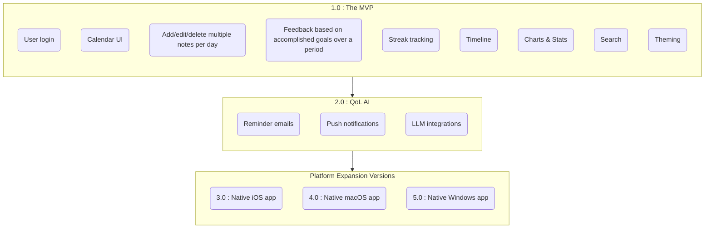

[https://mermaid.ai/open-source/syntax/flowchart.html]:#

# Ideal client test environment

* Chromium / Firefox / Safari
* React Dev tools

# Hosting options

* Cloudflare
* Google (Cloud, Firebase)
* Railway
* Vercel
* Wordpress

# Wellness Calendar

A cross-platform (status pending), simple lifestyle notebook to help you stay accountable.

| Platform | Repo |
|----------|------|
| Web  | https://github.com/LowComDenom/wellness-calendar-web.git |
| iOS     | https://github.com/LowComDenom/wellness-calendar-iOS.git |
| Windows | https://github.com/LowComDenom/wellness-calendar-win.git |

## Structure

All complex data mutation is done on the backend, all the client does is send, request, and display simple values.

```mermaid
flowchart LR

subgraph Backend
  DB[(-Database-)]
  r1{{db query}}
  API((-API-))
end

subgraph Client
  r2{{fetch}}
  CLI[-App-]
end

DB <--> r1 <--> API
API<--> r2 <--> CLI
```

## Key Technologies In 1.0

* JavaScript
* HTML
* CSS
* React
* React Router
* Express
* PostgresSQL

## Major Release Roadmap



## Technologies to experiment with later

### Frameworks

* .NET
* Angular
* Lit
* NextJS
* Nuxt
* SolidJS (most interesting)
* Svelte
* SwiftUI
* tailwindcss
* Vue 
* WinUI 3

### Languages

* C#
* Elixir (most interesting)
* Erlang
* Sass
* TypeScript (w/ Effect)

### Other

* VITE+
