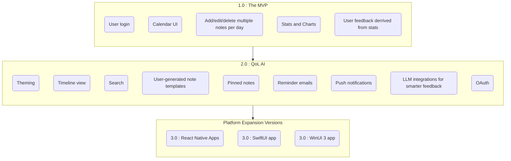
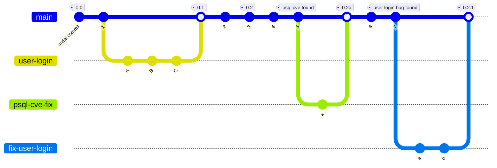

_https://mermaid.ai/open-source/syntax/flowchart.html_  
_https://expressjs.com/en/5x/starter/installing/_  

# Wellness Calendar

A cross-platform (status pending), simple lifestyle journal to help you stay accountable.

| Platform | Repo |
|----------|------|
| Web     | https://github.com/LowComDenom/wellness-calendar-web.git |
| iOS     | https://github.com/LowComDenom/wellness-calendar-iOS.git |
| Windows | https://github.com/LowComDenom/wellness-calendar-win.git |

# To-do

- [ ] Deploy web front end scaffold
- [ ] Complete database schema and queries
- [ ] Seed local database with mock data
- [ ] Complete API and routes
- [ ] Set up a real database
- [ ] Connect database to UI

# Hosting options

* Cloudflare
* Google
* Railway
* Vercel (most likely)
* Wordpress

# Ideal client test environment

Chromium w/ React Dev tools extension

## Structure

```mermaid
flowchart LR

subgraph Backend
  DB[(-Database-)]
  r1{{db query}}
  API((-API-))
end

subgraph Client
  r2{{fetch}}
  CLI[-App-]
end

DB <--> r1 <--> API
API<--> r2 <--> CLI
```

## Major Release Roadmap



## Versioning Scheme

https://semver.org/

### Representation of implementing the first feature on the web front end, then finding a bug later


