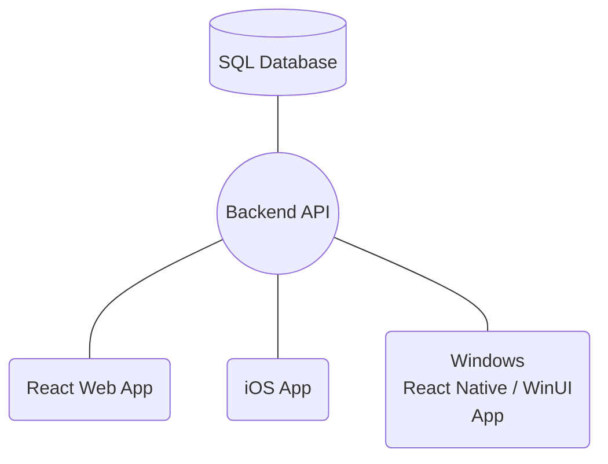
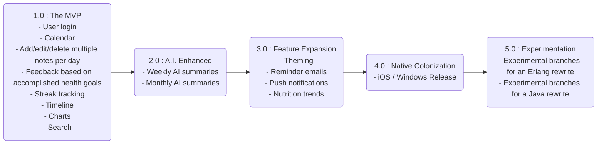
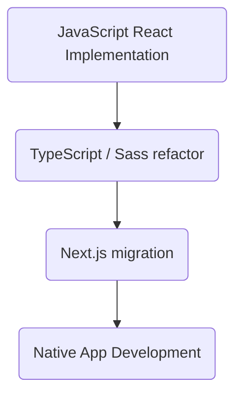

# Wellness Calendar

A cross-platform (status pending) wellness journal to help you stay accountable.

## Structure

[https://mermaid.ai/open-source/syntax/flowchart.html]: #

## Major Release Roadmap

## Technology Roadmap

