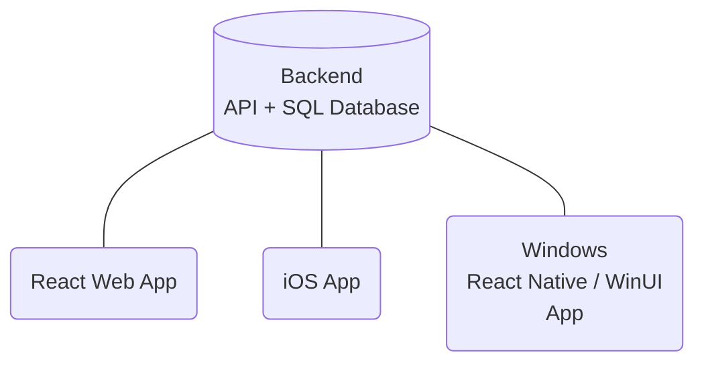
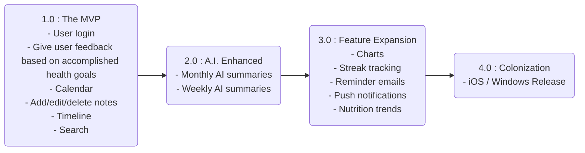
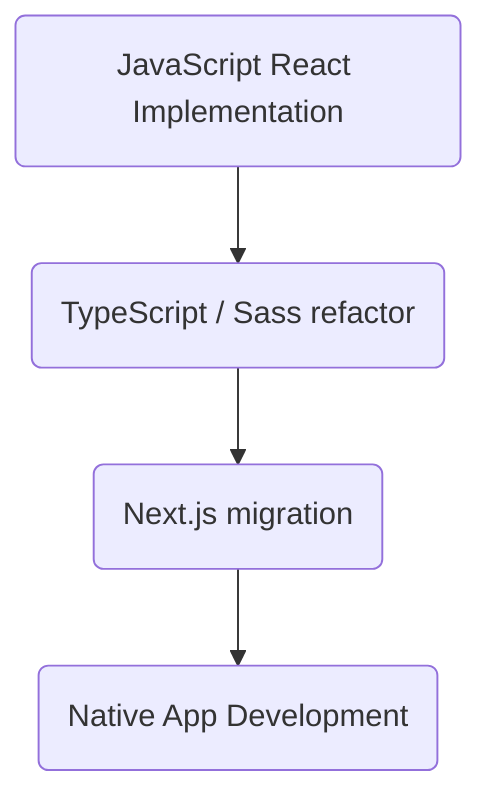

# Wellness Calendar

A cross-platform (status pending) diet accountability program.

## Structure

[https://mermaid.ai/open-source/syntax/flowchart.html]: #

## Major Release Roadmap

## Technology Roadmap

## Note Format
#### Meal Note
| Type of Note | Date |
| ------------------ | ----------- |
| Planned meal time | ... |
| Actual meal time |... |
| Pre-meal assessment | Hunger level: 0-10, type of hunger, environment |
| Meal details | food and drink consumed |
| Post-meal reflections | Fullness level: 0-10, type of hunger, environment |
| Grain, starch, or sugar? | (y/n) |
| Snacking? | (y/n) |
| Walked after meal? | (y/n) |

#### Fitness Note
| Type of Note | Date |
| ------------------ | ----------- |
| Yoga | (y/n) |
| Time | t |
| Walking, hiking | (y/n) |
| Distance & Time | (d/t) |
| Other | ... |

## Licensing

Remember to add the MPL header to source files
https://www.mozilla.org/en-US/MPL/headers/
