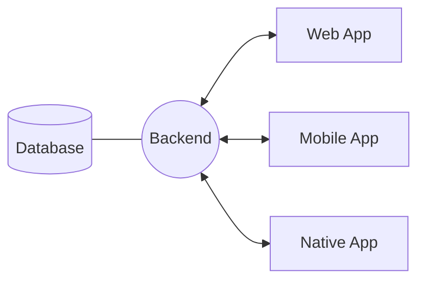
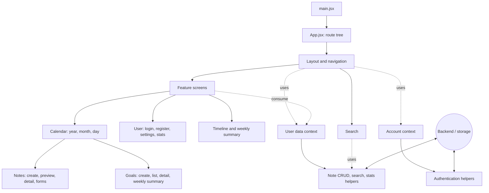
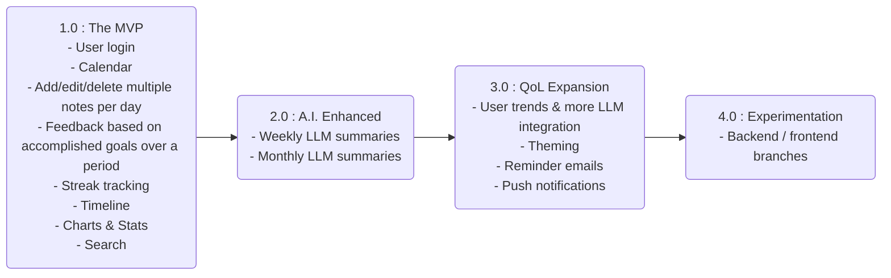
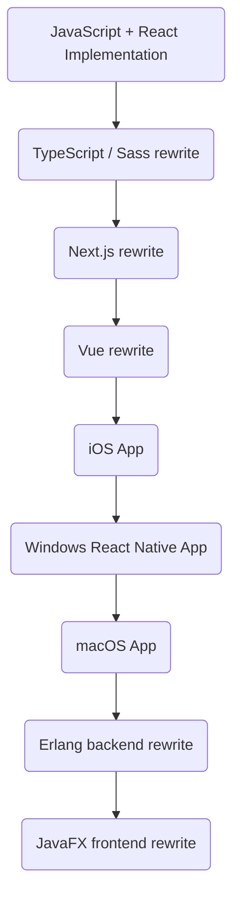

# Wellness Calendar

A cross-platform (status pending) wellness journal to help you stay accountable.

## Structure

[https://mermaid.ai/open-source/syntax/flowchart.html]: #

The 1.0 web frontend is organized around an application shell, screens, shared context, and focused helper functions:

## Major Release Features

## Technology Goals

