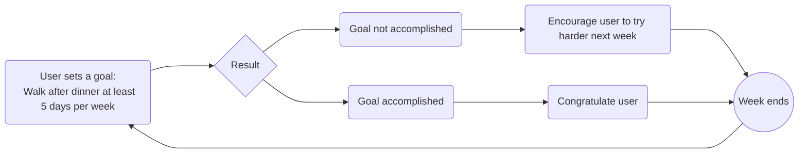

# Objects

## User

| Property | Description |
|----------|------|
| id       | |
| username | |
| password | |

## Note

| Property  | Description |
|-----------|------|
| user_id   | |
| date      | |
| title     | |
| note      | a note inside your note |
| type      | |
| body      | contains the fields/values as json |

## Goal

| Property       | Description |
|----------------|------|
| user_id        | |
| title          | |
| duration start | when the goal becomes active |
| duration end   | when the goal is either completed or not |
| description    | description of what the goal is |
| completed      | true/false depending if completed on time |

## Stats

| Property                | Description |
|-------------------------|------|
| user_id                 | |
| total notes             | |
| total notes of _x_ type | |
| total goals             | |
| goals completed         | |

# C.R.U.D. Notes

Users create notes and goals assigned to chosen calendar days

## Nutrition Note

| Type of Note             | Date                                              | Data Type |
| ------------------------ | ------------------------------------------------- | ----------- |
| Meal name                | Breakfast, Brunch, Lunch, Dinner, Snack...        |
| Planned meal time        | ...                                               |
| Actual meal time         | ...                                               |
| Pre-meal assessment      | Hunger level: 0-10, type of hunger, environment   |
| Meal details             | food and drink consumed                           |
| Post-meal reflections    | Fullness level: 0-10, type of hunger, environment |
| Grain, starch, or sugar? | (y/n)                                             |
| Snacking?                | (y/n) if yes, prompt creation of a nutrition note |
| Walked after meal?       | (y/n) if yes, prompt creation of a fitness note   |

## Fitness Note

Fitness notes will be based on presets created by users.

| Type of Note                         | Date  |
| -------------------------------------| ----- |
| Exercise type                        | ...   |
| Other fields generated based on type | ...   |

# C.R.U.D. Goals

Users set goals and receive feedback based on note content at the end of a period of time. (recurring goals allowed)

## Goal Logic Example

_Goal logic should ultimately be based on unit values_

# Stats

* User stats calculated when server recieves **new** data
* Displayed as charts on a dedicated page
