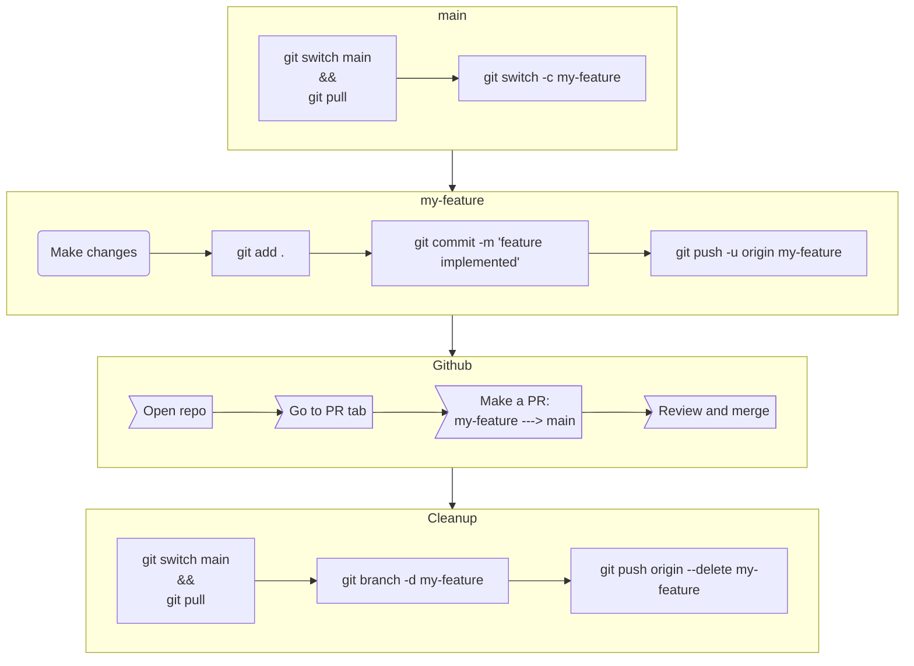

# Submodules

## Init submodules according to currently specified commit
`git submodule update --init --recursive`

## Sync all with main
`git submodule foreach --recursive 'git checkout main && git pull'`

## Delete a submodule
`git submodule deinit -f path/to/submodule
git rm -f path/to/submodule
rm -rf .git/modules/path/to/submodule
git commit -m "Remove submodule"`

# Feature branch lifecycle

### Pull current main and make a new branch
`git switch main
git pull
git switch -c my-feature`

### Commit and push after making changes
`git add .
git commit -m 'Implement feature'`  
`git push -u origin my-feature`  
`-u` sets up the upstream so subsequent pushes can simply be `git push`

### Push and make a pull request
On GitHub:
  * Open the repository.
  * Go to the Pull requests tab, or follow the prompt for your newly pushedbranch.
  * Create a PR from my-feature → main.  
*likely ends here for this class* 
  * Review the changes and merge when ready.

### Cleanup local

`git switch main
git pull`  
Delete local branch:  
`git branch -d my-feature`  
Maybe delete remote branch too:  
`git push origin --delete my-feature`
